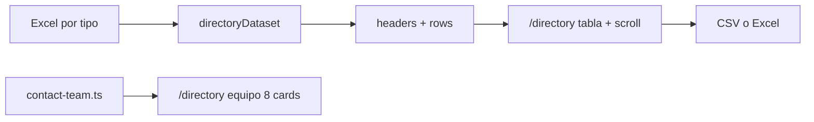

# Spec: Equine directory (phase 1)

> Status: **implemented** — Excel-per-type in Sanity; table UI with filter / search / sort / download / scroll; fixed contact team cards  
> Path: `/directory`  
> Domain: product definition for this page (equine Excel tables + staff contact section)

## Identification

| Field | Value |
| --- | --- |
| Id | `directory` |
| Phase | 1 |
| Depends on | `foundation`, Sanity Studio |
| Feature folder | `features/directory` |

## Goal

Offer a searchable library of contacts related to Asdeoccidente (schools, pesebreras, vets, riders, etc.). Editors upload **one Excel per type**; the public table mirrors the Excel columns exactly. Below the table, show the official staff contact cards (name, role, email, phones).

## Layout

1. **PageHero** — badge + h1 + subtitle + image (**no CTA**)
2. **Toolbar** — type chips · search · sort by column · download Excel (original) and/or CSV
3. **Table** — headers/rows from the active published dataset; **max-height scroll** with sticky header so long lists do not stretch the page
4. **Contact team** — title + subtitle + 8 cards in a 2×4 grid (desktop): role, name, email, phones
5. Empty / no-results states in Spanish
6. Shared ContactLocation / Footer (general email / phones / address stay in the footer only)

## CMS model

### `directoryPage` (singleton)

Hero (badge, title, subtitle, image), empty-state copy, SEO.

### `directoryDataset` (one doc = one type)

| Field | Notes |
| --- | --- |
| `title` / `slug` / `sortOrder` / `published` | Type identity and filter order |
| `sourceFile` | Excel (`.xlsx` / `.xls`) asset |
| `processExcel` | Studio control: parse first sheet → `headers` + `rows` |
| `headers` | Column labels (from Excel) |
| `rows[].cells` | Cell values aligned to headers |

Runtime reads **headers/rows** only (does not re-parse Excel on each request). Download can use original file URL and/or client-generated CSV.

### Contact team (code-fixed)

Staff title, subtitle, and members live in `features/directory/models/contact-team.ts` until a Sanity model exists. No schema fields on `directoryPage` for this block yet.

## Content rules

- No invented directory rows in code defaults for Excel tables
- Association uploads real Excels and presses **Procesar Excel** then **Publicar**
- Staff contact copy matches KB §1 «Directorio (contacto oficial)» and `contact-team.ts`

## Acceptance

- [x] Spec + feature `features/directory`
- [x] `directoryPage` + `directoryDataset` in Studio
- [x] Banner without CTA; type / search / sort / download
- [x] Table scroll (max-height + sticky header)
- [x] Contact team section (fixed `contact-team.ts`, 2×4 cards)
- [ ] Association seeds real Excels (no invented contacts in repo)
- [ ] Mobile review
