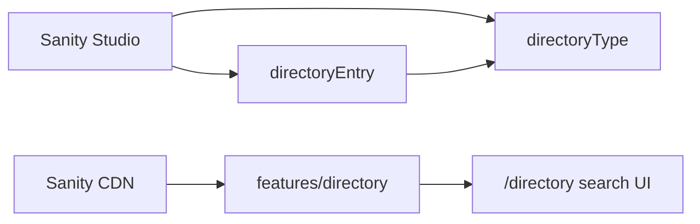

# Spec: Equine directory (phase 1)

> Status: **spec only** — stub route for nav; **search UI and Sanity schemas not implemented yet**  
> Path: `/directory`  
> Domain: product definition for this page (not the KB “Directorio contacto oficial” staff table)

## Identification

| Field | Value |
| --- | --- |
| Id | `directory` |
| Phase | 1 (spec) · implementation later |
| Depends on | `foundation`, Sanity Studio |
| Feature folder | later `features/directory` |

## Goal

Offer a searchable “library” of contacts and places related to Asdeoccidente: schools, representatives, stables (pesebreras), doctors, veterinarians, riders (montadores), and other types the association adds — so visitors can find names, emails, addresses, and phones when they need them.

## Expected result (when implemented)

- Page `/directory` with Spanish UI
- Filter by **type**; text search; sort by configurable fields
- Data owned in Sanity; editors manage types and entries without code changes
- Shared layout; SEO; empty state when no published entries
- **This branch:** stub only (`Próximamente` + short explanation)

## Scope / out of scope

**In:** dynamic type definitions, entries, search/filter/sort, Studio authoring.

**Out of this branch:** Sanity schemas, React Query feature, search UI beyond stub.

**Not this page:** junta/staff contact table in KB §1 (that stays About/contact). Registros fee table is a separate concern (`[por confirmar]`).

## Sections (implementation order)

1. **Hero** — title + short help text (cómo buscar)
2. **Toolbar** — type filter, search input, sort control
3. **Results** — cards from `showInCard` fields
4. **Detail** — panel or `/directory/[slug]` from `showInDetail` fields
5. Empty / no-results states in Spanish

## Proposed CMS model (implement later)

### `directoryType`

Defines a category (Escuela, Pesebrera, Veterinario, Montador, Doctor, Representante, …).

| Field | Notes |
| --- | --- |
| `title` | Spanish label |
| `slug` | English/slug for filters |
| `icon` | Optional string key for Lucide (or omit) |
| `sortOrder` | List order in filter UI |
| `fields[]` | Dynamic field definitions |

Each item in `fields[]`:

| Property | Notes |
| --- | --- |
| `key` | Stable id (e.g. `email`, `phone`, `address`) |
| `label` | Spanish label in Studio + UI |
| `fieldType` | `string` \| `email` \| `phone` \| `url` \| `text` |
| `required` | boolean |
| `searchable` | include in text search |
| `sortable` | allow sort-by in UI |
| `showInCard` | list card |
| `showInDetail` | detail view |

### `directoryEntry`

| Field | Notes |
| --- | --- |
| `type` | Reference → `directoryType` |
| `name` | Display name (always) |
| `slug` | Optional SEO slug |
| `published` | Only published entries on the site |
| `values[]` | `{ fieldKey, value }` matching type field keys |
| `notes` | Optional internal/public note `[definir]` |

Studio: create types first, then entries. Soft-warn unknown `fieldKey`s.

## Front-end intent (later)

- Load types + published entries from Sanity CDN (React Query)
- Filter by type; query across `searchable` fields; sort by `sortable` (default: `name`)
- No invented directory rows in code defaults

## Default stub copy

| Element | Value |
| --- | --- |
| Title | Directorio equino |
| Subtitle | Escuelas, pesebreras, veterinarios, montadores y más. El catálogo buscable llega pronto. |
| CTA | WhatsApp general while stub |

## Acceptance

- [x] Spec documents UX + Sanity model
- [x] Stub `/directory` for nav (no search UI yet)
- [ ] `directoryType` / `directoryEntry` schemas in Studio
- [ ] Search, filter, sort on `/directory`
- [ ] Association seeds real entries (no invented contacts in repo)
